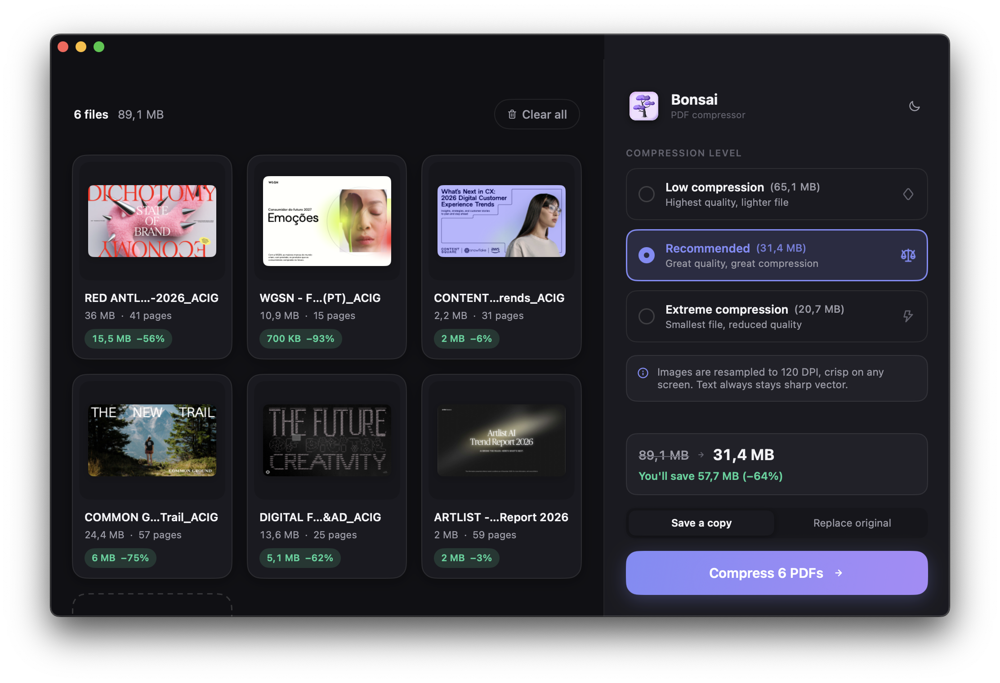

# Bonsai

**Compress PDFs. Keep the quality. Never leave your Mac.**

Bonsai is a small native macOS app that shrinks PDF files locally. No uploads, no accounts, no size limits, no subscription. Drop files, pick a preset, press one button.



## Why Bonsai

- **100% local and private.** Your documents never touch a server.
- **Nothing breaks.** Only image data is re-encoded. Every other object in the file keeps its exact bytes: text, vector art, fonts, gradients, transparency groups, blend modes, Figma inner shadows and glows, annotations, links, form fields and outlines.
- **Quality is measured, not guessed.** Each image gets the lowest JPEG quality that still matches its original by SSIM, so smooth gradients take a few kilobytes while detailed photos and film grain keep what they need.
- **Never inflates.** If compression wins less than 2%, you get your original bytes back, labeled "Already optimized".

## Presets

| Preset | Images | Design deck exported from Figma, 19 MB |
|---|---|---|
| **Low compression** | Visually identical even when zoomed in, never denser than 600 ppi | RESULT_LOW |
| **Recommended** | Sharp on Retina displays, never denser than 300 ppi | RESULT_RECOMMENDED |
| **Extreme compression** | Sized for full screen viewing, never denser than 150 ppi | RESULT_EXTREME |

Pixel density is measured at the largest size each image is drawn on any page, so an avatar exported at 1024 pixels and placed at the size of a thumbnail shrinks, while a full-bleed photo keeps its resolution.

Click any compressed file for a before/after slider at full resolution.

## Features

- Batch compression: drop a whole folder's worth of PDFs at once
- Per-file and total savings after every run
- Before/after comparison with per-page navigation
- Day and Night themes (Shift-Cmd-D)
- "Save a copy" or "Replace original" (the original goes to the Trash; the swap is staged, so a failed save never loses your file)
- Password-protected and broken files are detected and skipped
- Drag PDFs onto the Dock icon, or use Cmd-O

## How it works

1. qpdf lists every object in the file and extracts the streams.
2. Bonsai follows every page, form XObject and soft mask group with its transformation matrix to learn how large each image is drawn.
3. Byte-identical images (design tools often embed one bitmap per page) collapse into one.
4. Images are re-encoded with mozjpeg as baseline JPEG, the form every PDF reader decodes:
   - JPEGs get the lowest quality that keeps SSIM above the preset's target and smooth areas free of banding;
   - losslessly stored images (PNG-like) become JPEG only when they are photographic: the result must also pass an outlier and ringing check on visible pixels, so text, line art and UI screenshots stay lossless and are only re-packed with PNG predictors;
   - soft masks, the alpha channels behind glows, blurs and shadows, become JPEG only when every pixel stays within a few levels of the original;
   - images denser than the preset allows are downsampled together with their masks by area averaging, weighted by opacity so hidden pixels never bleed into visible edges.
5. qpdf writes the new image streams into the original file. Nothing else is rewritten; compressed page content is only re-packed losslessly.
6. Every page is rendered next to the original with Apple's renderer; a page that drifts is copied back from the original.

Images that can also be drawn from places Bonsai does not trace, such as patterns, Type 3 glyphs or annotation appearances, are re-encoded but never downsampled.

Results were checked page by page against the originals with seven independent PDF engines: Core Graphics on macOS and iOS (Preview, Safari, Telegram on iPhone), PDFium (Chrome, Edge, Android), pdf.js (Firefox), poppler, MuPDF and Ghostscript, on exports from Figma, Illustrator, InDesign, Photoshop, Keynote, PowerPoint, Canva, CorelDRAW and scanners.

## Install

Grab the zip from the [latest release](https://github.com/finkoegor/Bonsai/releases/latest), unzip and drop Bonsai.app into /Applications. Releases are signed with a Developer ID and notarized by Apple, and keep themselves up to date with Sparkle.

Bonsai compresses with two free command line tools. Install them once with [Homebrew](https://brew.sh):

```bash
brew install qpdf mozjpeg
```

Or build from source:

```bash
git clone https://github.com/finkoegor/Bonsai
cd Bonsai
./build.sh install
```

The app lands in /Applications; every later `./build.sh` refreshes the installed copy. Requires macOS 14 or later.

## Known limitations

- JPEG 2000, CMYK JPEG, 16-bit and 1-bit images are left as they are.
- Encrypted PDFs are skipped; unlock them first.

## License

MIT © 2026 Egor Finko.

Third-party: [Sparkle](https://github.com/sparkle-project/Sparkle) (MIT) powers updates; icons are [Unicons by Iconscout](https://github.com/Iconscout/unicons) (IconScout Simple License). [qpdf](https://github.com/qpdf/qpdf) (Apache 2.0) and [mozjpeg](https://github.com/mozilla/mozjpeg) (IJG and BSD licenses) are separate programs installed with Homebrew and run as external processes; they are not distributed with the app.
