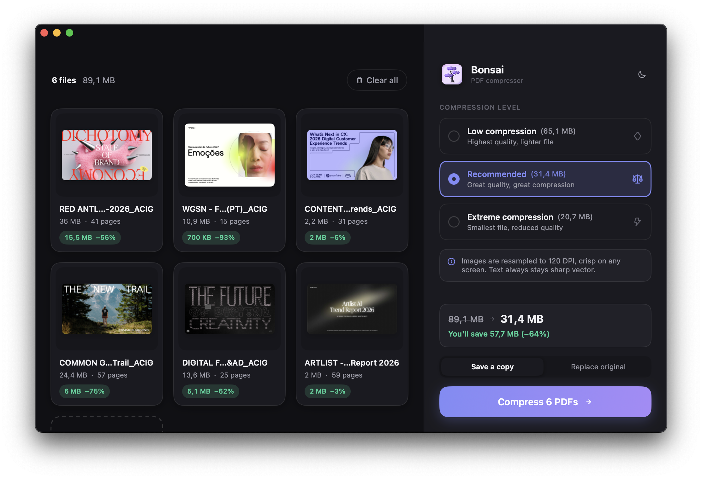

# Bonsai

**Compress PDFs. Keep the quality. Never leave your Mac.**

Bonsai is a small native macOS app that shrinks PDF files locally. No uploads, no accounts, no size limits, no subscription. Drop files, pick a preset, press one button.



## Why Bonsai

- **100% local and private.** Your documents never touch a server.
- **Nothing breaks.** Text stays text and vectors stay vectors. Fonts, gradients, transparency groups, blend modes, Figma inner shadows and glows, annotations, links, form fields and outlines are the same objects as before. Only images are re-encoded, and drawing instructions are written more compactly.
- **Only what shows is kept.** Design tools store a whole photo behind every card and crop it on the page. Bonsai keeps the part that can be seen, at the resolution a screen can show.
- **Quality is measured, not guessed.** Each image gets the lowest JPEG quality at which both the image as a whole and its worst areas (small text, logos, edges) still match the original by SSIM, so smooth gradients take a few kilobytes while UI screenshots, detailed photos and film grain keep what they need.
- **Never inflates.** If compression wins less than 2%, you get your original bytes back, labeled "Already optimized".

## Presets

| Preset | Images | Design deck exported from Figma, 31.4 MB |
|---|---|---|
| **Low compression** | Visually identical even when zoomed in, 300 to 450 ppi | 13.5 MB (-57%) |
| **Recommended** | Sharp with the page filling a Retina or 5K display, 150 to 200 ppi | 5.5 MB (-82%) |
| **Extreme compression** | Sized for an ordinary display, 110 to 150 ppi | 4.0 MB (-87%) |

Across 18 test files from 13 different exporters (323 MB in total) the presets give 235 MB, 126 MB and 101 MB, at about four seconds per file. Files whose pages are themselves low-resolution bitmaps compress the least: on screen they are already stretched, and so would be any compression artifact.

The density depends on the page: a wide slide fills a screen with fewer pixels per inch than a small sheet does, so its images need less. It is measured at the largest size each image is drawn on any page, so an avatar exported at 1024 pixels and placed at the size of a thumbnail shrinks, while a full-bleed photo keeps its resolution.

Click any compressed file for a before/after slider at full resolution.

## Features

- Batch compression: drop a whole folder's worth of PDFs at once
- Per-file and total savings after every run
- Before/after comparison with per-page navigation
- Day and Night themes (Shift-Cmd-D)
- "Save a copy" or "Replace original" (the original goes to the Trash; the swap is staged, so a failed save never loses your file)
- Password-protected and broken files are detected and skipped
- Drag PDFs onto the Dock icon, or use Cmd-O

## How it works

1. qpdf lists every object in the file and extracts the streams.
2. Bonsai follows every page, form XObject and soft mask group the way a renderer does, with its transformation matrix, clipping paths and masks, to learn how large each image is drawn and which part of it can show.
3. Byte-identical images (design tools often embed one bitmap per page) collapse into one, and soft masks that hide nothing are dropped.
4. Images are cut down to their visible part. The cut image is painted through a small form XObject in the place of the old one, so page content that draws it stays as it is. A JPEG that only needs cutting is cut without decoding, pixel for pixel.
5. Images are re-encoded with mozjpeg as baseline JPEG, the form every PDF reader decodes:
   - JPEGs get the lowest quality that keeps SSIM above the preset's target, both on average and in the worst 1% of 8x8 windows placed across JPEG block borders, and keeps smooth areas free of banding; images that are stretched on screen (drawn below the preset's viewing density) must stay proportionally closer to the original;
   - losslessly stored images (PNG-like) become JPEG only when they are photographic: the result must also pass an outlier and ringing check on visible pixels, so text, line art and UI screenshots stay lossless and are only re-packed with PNG predictors;
   - soft masks, the alpha channels behind glows, blurs and shadows, become JPEG only when every pixel stays within a few levels of the original;
   - images denser than the preset allows are downsampled together with their masks, weighted by opacity so hidden pixels never bleed into visible edges;
   - color that cannot be seen through an alpha channel, such as the noise design tools leave in drop shadows, is evened out before encoding, and quality is judged on what reaches the screen.
6. Page content and form XObjects get their numbers shortened: a coordinate written with six decimals keeps four to six, a change of at most 0.00005 points. Every stream is then deflated at the highest level.
7. qpdf writes the new streams into the original file.
8. Every page is rendered next to the original with Apple's renderer; a page that drifts is copied back from the original.

Images that can also be drawn from places Bonsai does not trace, such as patterns, Type 3 glyphs or annotation appearances, are re-encoded but never cut or downsampled. So are images painted under a soft mask, a constant alpha or a blend mode set outside them, which PDFium would apply wrongly to the form XObject around a cut image.

Results were checked page by page against the originals with seven independent PDF engines: Core Graphics on macOS and iOS (Preview, Safari, Mail, Telegram on iPhone), PDFium (Chrome, Edge, Android), pdf.js (Firefox and most web viewers), poppler, MuPDF and Ghostscript, on exports from Figma, Illustrator, InDesign, Photoshop, Keynote, PowerPoint, Canva, CorelDRAW and scanners, and on synthetic files built around clipping, soft masks, knockout groups and blend modes.

## Install

Grab the zip from the [latest release](https://github.com/finkoegor/Bonsai/releases/latest), unzip and drop Bonsai.app into /Applications. Releases are signed with a Developer ID and notarized by Apple, and keep themselves up to date with Sparkle.

Bonsai compresses with two free command line tools. Install them once with [Homebrew](https://brew.sh):

```bash
brew install qpdf mozjpeg
```

Or build from source:

```bash
git clone https://github.com/finkoegor/Bonsai
cd Bonsai
./build.sh install
```

The app lands in /Applications; every later `./build.sh` refreshes the installed copy. Requires macOS 14 or later.

## Known limitations

- JPEG 2000, CMYK JPEG, 16-bit and 1-bit images are left as they are.
- PDFs that need a password to open are skipped; unlock them first. Files protected only against editing are compressed and stay protected.

## License

MIT © 2026 Egor Finko.

Third-party: [Sparkle](https://github.com/sparkle-project/Sparkle) (MIT) powers updates; icons are [Unicons by Iconscout](https://github.com/Iconscout/unicons) (IconScout Simple License). [qpdf](https://github.com/qpdf/qpdf) (Apache 2.0) and [mozjpeg](https://github.com/mozilla/mozjpeg) (IJG and BSD licenses) are separate programs installed with Homebrew and run as external processes; they are not distributed with the app.
